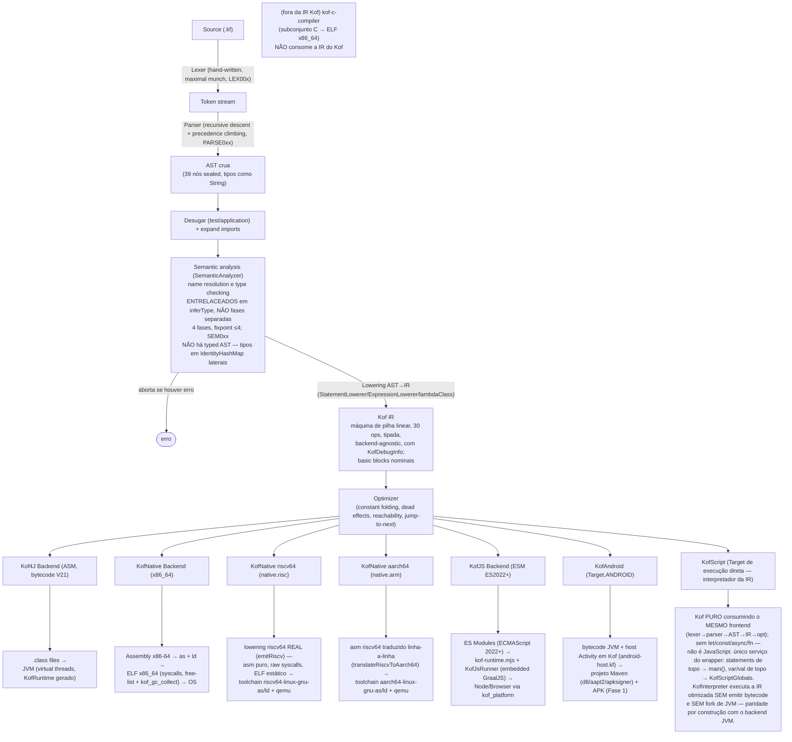
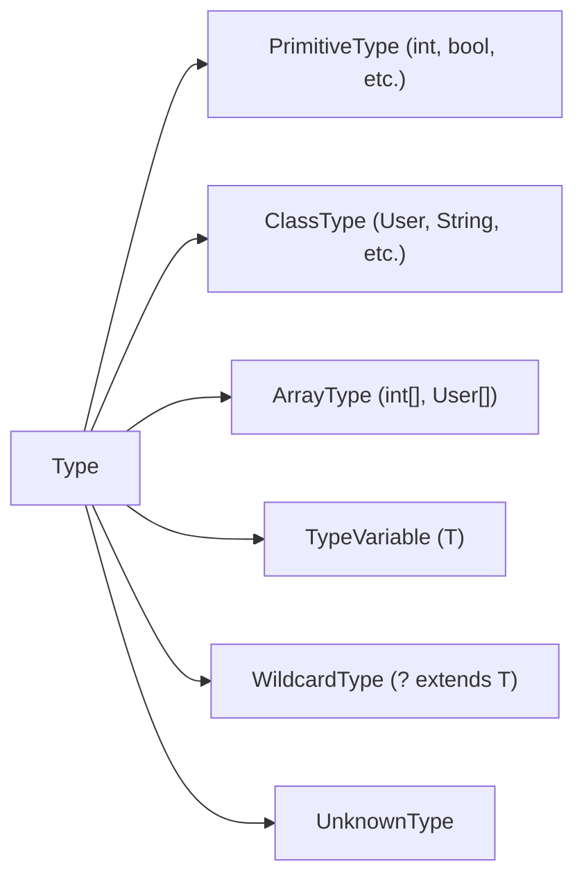
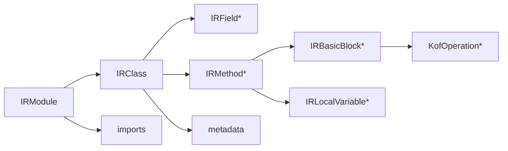
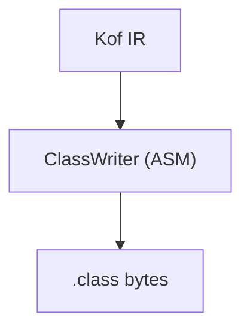
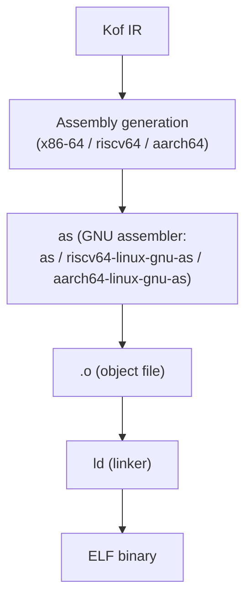
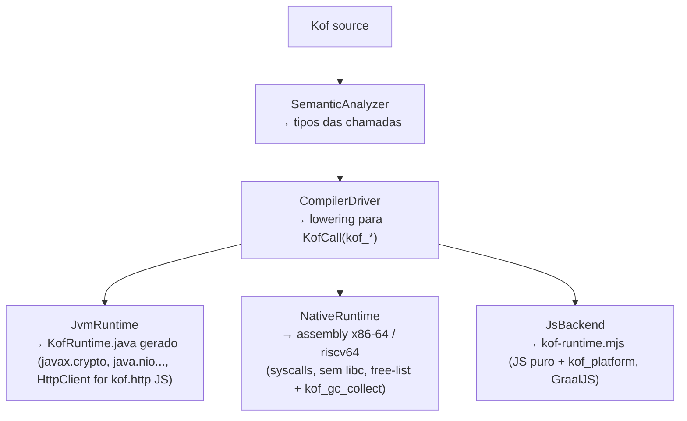

[English](architecture.md) | [Português](architecture.pt_BR.md)

# Architecture Decision Record

## Project: Kof

## Status: Accepted

**Última atualização:** 13 de setembro de 2026
**Versão:** 0.6.7

> **Melhoria visual 13/09 (issue #109):** os diagramas em ASCII deste ADR
> (Pipeline, Type Representation, IR, backends e dispatch da stdlib) passaram
> a **Mermaid** — o GitHub renderiza nativamente; conteúdo e fatos inalterados
> (só a notação). Blocos de terminal (ex.: exemplo de diagnóstico) continuam
> `text`.

> **Este ADR registra a decisão arquitetural (multi-target via frontend
> compartilhado + backends plugáveis).** A descrição **completa e atual** da
> implementação do compilador (pipeline real, IR, lowering, otimizações,
> backends, targets, terminologia) está em
> [`compiler-architecture.md`](compiler-architecture.md). A **especificação da
> linguagem** (independente desta implementação) está em
> [`language-reference/`](../language-reference/).
>
 > **Correções 06/09 (auditoria):** (a) riscv64 e aarch64 **não** são mais
 > "placeholder x86_64" — riscv64 tem lowering real (`NativeBackend.emitRiscv`)
 > e aarch64 é traduzido do riscv64 (`translateRiscvToAarch64`); (b) **KofC**
 > não consome a IR do Kof (subconjunto C → ELF); **KofScript consome o MESMO
 > frontend** (lexer→parser→AST→IR) e executa a IR otimizada no interpretador
 > (target de execução direta, 0.4.0-beta); (c) a IR é uma **máquina de pilha
 > linear** (30 ops), não uma "árvore". Ver SG-E1/SG-E3 em
 > [`specification-gaps.md`](../bugs-and-gaps/specification-gaps.md).

## Context

Kof é uma linguagem de programação estaticamente tipada e orientada a objetos. O compilador deve gerar código para múltiplos targets a partir de uma única IR.

Uma linguagem. Um compilador. Múltiplos targets.

## Pipeline



## Decision: Multiplatform via Shared Frontend + Pluggable Backends

### Rationale

1. **One language, multiple targets.** The same Kof source compiles to JVM, native, script, or web.
2. **Shared frontend.** Lexer, parser, AST, type system, and semantic analysis are shared across all backends.
3. **Pluggable backends.** Each target has its own backend that consumes the same IR.
4. **No transpilation.** Kof generates bytecode directly for JVM, assembly for native.
5. **No Java intermediate.** Kof does not generate Java source code.

### Backend Interface

```java
public interface Backend {
    void emit(IRModule module, Path outputDir) throws IOException;
}
```

Implementations:
- `JvmBackend` - generates `.class` files via ASM (`kof-compiler/src/main/java/dev/kof/compiler/jvm/JvmBackend.java:1`)
- `NativeBackend` - generates ELF via assembly + `as` + `ld` (x86_64 stable, riscv64/aarch64 via cross toolchain)
- `JsBackend` - generates ES Modules (ECMAScript 2022+), executed by the embedded GraalJS engine (`KofJsRunner`)
- `KofCCompiler` - C subset (`kof c`) → ELF x86_64 native-only (`kof-c-compiler/src/main/java/dev/kof/c/KofCCompiler.java:1`)

### Target Enum

```java
public enum Target {
    JVM,
    NATIVE,          // x86_64 stable (free-list + kof_gc_collect, pthread spawn 31/08)
    NATIVE_RISCV64,  // native.risc: lowering riscv64 real (NativeBackend.emitRiscv) + toolchain riscv64 + qemu
    NATIVE_AARCH64,  // native.arm: tradução do riscv64 (translateRiscvToAarch64) + toolchain aarch64 + qemu
    JS,              // alpha (GraalJS)
    ANDROID          // Fase 1: projeto Maven + APK (bytecode JVM + host Activity em Kof)
}
```

CLI: `kof build/run --target jvm|native|native.risc|native.arm|js` (aliases `native.riscv64`/`native.aarch64`; `android` em Fase 1) (`CompilerDriver.java:1`, `Target.java:1`). `kof run`/`kof build --target js` executa JS sem Node.js (runtime embarcado). `kof c` usa `KofCCompiler` apenas para `native`.

## Type System

The type system supports (0.5.0-beta, re-synced 17/09/2026):

- Primitive types: `bool`, `byte`, `short`, `int`, `long`, `float`, `double`, `char`
- Reference types: classes, interfaces, enums (with `values()/valueOf` + exhaustiveness), records
- Generic types: `List<T>`, `Map<K,V>`, `Set<T>`, `Box<T>` (erasure, `Box<Int>` works via `substituteTypeVariable` `CompilerTypes.java:423`)
- Type parameters: `<T>` (implemented, erasure); bounds (future)
- Wildcards: `?`, `? extends T`, `? super T` (future)
- Arrays: `int[]`, `String[]`
- Null safety: `String?` basic (`Type?` nullable, compile-time `?`-check) — since 0.2.6-beta
- Pattern matching: `switch` with `case String s` + record destructuring `Point(x,y)` — JVM/Native/JS (since 0.2.6-beta)
- Void type
- Function types: `FunctionType` (lambdas with captures via `BoxN`, implemented)

### Type Representation



## IR

The IR is a backend-agnostic lowered representation of the AST.



### KofOperation types

- **Literals**: KofLoadLiteral (int, long, float, double, string, bool, null)
- **Variables**: KofLoadLocal, KofStoreLocal
- **Fields**: KofLoadField, KofStoreField, KofGetStatic, KofPutStatic
- **Arithmetic**: KofBinary (ADD, SUB, MUL, DIV, MOD), KofUnary (NEG, NOT)
- **Comparisons**: KofConditionalJump (EQ, NE, LT, LE, GT, GE)
- **Control flow**: KofLabel, KofJump, KofConditionalJump
- **Calls**: KofCall (INSTANCE, STATIC, CONSTRUCTOR, FUNCTION)
- **Object creation**: KofNewObject
- **Return**: KofReturn, KofReturnVoid
- **Stack**: KofDup, KofPop
- **Type ops**: KofCheckCast, KofInstanceOf
- **Arrays**: KofArrayLoad, KofArrayStore, KofNewArray, KofArrayLength
- **Exception**: KofThrow

### Labels

Labels use `LabelId` (integer-based), not ASM Labels.

```java
record LabelId(int id) { ... }
```

Each backend maps LabelId to its own representation (ASM Label for JVM, assembly labels for native).

## JVM Backend

The JVM backend uses ASM to generate class files.



The backend produces:
- Correct constant pool
- Correct method descriptors
- StackMapTable
- LineNumberTable (debugging)
- LocalVariableTable (debugging)

Runtime JVM (`KofRuntime` gerado; base 30-31/08, re-synced 17/09): web stack
(`web.app()`, rotas, middleware, `status`/`headerSet`), **WebSocket**
(`app.ws`, handshake RFC 6455 + frame codec com máscara) e **SSE**
(`sse.send/event/close`), `kof.cache` (get/set/ttl/delete/clear), `kof.http`
client com **retry/circuit breaker** (`KOF_HTTP_RETRIES`/`KOF_HTTP_TRIPS`/
`KOF_HTTP_FAILURES`/`KOF_HTTP_OPEN_UNTIL`, janela de 30s, fail-fast),
`KofRuntime.close` (fechamento de descritores ws).

## Native Backend

The native backend generates ELF binaries (0.6.0).



Targets (0.5.0-beta, re-synced 17/09):
- `native` (x86_64) **stable**: ELF x86_64, syscalls, free-list allocator (`kof_free_head`; mark-sweep implementado 03/09, `kof_gc_collect_now` manual — **auto-collect sob exaustão ✅ 19/09 (D1-A, §260 FECHADO)**; fallback `munmap`), strings/lists/JSON (objetos/records + arrays FP, 31/08), exceptions with unwinding, `spawn`/`await` via `pthread_create` + trampoline + `pthread_join` com allocator thread-safe (futex) — CONC001 (31/08), FP real em XMM (`vcvtsi2sd`/`mulsd`, dtoa via `snprintf`) — FLT001, `kof_db_mysql_scramble` + wire protocol em progresso
- `native.risc` (riscv64) **real**: lowering riscv64 (`NativeBackend.emitRiscv`); `riscv64-linux-gnu-as/ld` + qemu
- `native.arm` (aarch64) **real**: tradução do riscv64 (`translateRiscvToAarch64`); `aarch64-linux-gnu-as/ld` + qemu

Current capabilities (x86_64):
- Record structs with fields, constructors, accessors, inheritance 3 levels, virtual dispatch via vtable
- Integer arithmetic, bitwise, floating-point real em XMM (`vcvtsi2sd`/`mulsd`), control flow (if/else, while/for/do-while/break/continue, switch with pattern matching)
- Function calls (all forms), lambdas with captures (`BoxN`), exceptions (unwinding), `spawn`/`await` com threads (pthread, 31/08)
- Strings, arrays, `List<T>` with `map/filter/reduce`, `Map<K,V>`, `Set<T>`, `Box<T>` (`kof_int_to_string`), JSON objetos/records + arrays (Int/Long/Bool/String/Double, 31/08)
- `kof.io`, `kof.time` (now/sleep), `kof.config` (asm próprio, `/proc/self/environ`), `kof.log` (asm), `kof.security` (SHA-256/HMAC asm), `kof.cache` (30/08 — clobber de registradores corrigido), `kof.db` SQLite (`.so` direto) + MySQL wire protocol (scramble SHA-1; 13 faces ORM reais no x86-64, F2d1–F2d7 22/09)

Runtime functions (x86-64, `NativeRuntime.java:1`):
- `kof_alloc` / `kof_free_head` free-list (reuso mmap) / `kof_gc_collect` (mark-sweep implementado 03/09)
- `kof_print` / `kof_println` / `kof_print_int` / `kof_int_to_string`
- `kof_string_*`, `kof_array_*`, `kof_list_*`, `kof_map_*`, `kof_cache_*`, `kof_db_mysql_scramble`
- trampoline de `pthread_create` + `pthread_join` (spawn/await, 31/08)
- `kof_panic`, `kof_null_error`, `kof_bounds_error`

## JsBackend

- Generates ES Modules, executed by embedded GraalJS (`KofJsRunner`) — no Node.js required
- Supports pattern matching (`case String s` + `Point(x,y)` via `typeof` + destructuring), `String?` basic, `kof.http` via `Java HttpClient` interop (+ fetch fallback; retry/circuit em paridade com o JVM, 30/08), `List map/filter/reduce`, `Box<T>` via `substituteTypeVariable`
- Scheduler `kof.time` via `setInterval` (27/08); `spawn`/`await` com async/await/Promise reais (statement/expressão; CONC003 fechado 03/09)
- Status alpha (0.6.0)

## KofCCompiler

- C subset compiler (`kof c` — native-only): `int` globals, `void` funcs, `if`/`while`/`*(int*)`/`&`, → ELF x86_64 via `kof_c` (`KofCCompiler.java:1`)

## KofScript Runtime

KofScript é um **target de execução direta**: Kof puro executado pelo
interpretador da IR, sem etapa de compilação e sem fork de JVM
(0.6.0). **Não é JavaScript** — `let`/`const`/`async`/`fn` não
existem; falham com o diagnóstico normal do parser Kof.

```bash
kof run program.kf
kof script app.kf [--watch]
kof repl
```

Implementation:
- Mesmo frontend do compilador (lexer→parser→AST→semântica→lowering→IR
  otimizada) via `CompilerDriver.interpret(...)`
- `KofInterpreter` executa a IR como stack machine sobre valores reais do
  JDK; classes Kof viram `KofObj` interpretado; builtins sem lambda são
  despachados ao `KofRuntime` gerado — **paridade por construção** com o
  backend JVM (mesma IR)
- `var`/`val` at top-level desugars to `KofScriptGlobals` fields
  (Kof não tem variável top-level — único serviço do wrapper)
- Caminho compilado (`runFileCompiled`) permanece como fallback e é
  usado nos testes de paridade; JS/Native continuam no caminho compilado
- Cleans up temp files; `--watch` re-executes on change; SIGPIPE handled on Windows

## Standard Library (compile-time dispatch)

A Standard Library do Kof é implementada como **tabelas de dispatch
compile-time** (docs/stdlib/stdlib.md): cada módulo é um descriptor no compilador
(`KofIo.java`, `KofWeb.java`, `KofSecurity.java`, `KofUi.java`) que mapeia a
intenção do programador para funções de runtime `kof_*`:



Gaps de target produzem **diagnósticos claros em compile-time** (SECN00x,
CONC001, JSN00x, DB001, CONF001, LOG001) — nunca comportamento silenciosamente diferente.

Módulos (0.5.0-beta, re-synced 17/09): `kof.core`, `kof.collections` (`List map/filter/reduce`, `Map/Set`, `Box<T>`), `kof.io`, `kof.time` (scheduler `every` JVM+JS via `setInterval`), `kof.json` (objetos/records + arrays nos 3 targets, 31/08), `kof.http` (JVM+JS via HttpClient; retry/circuit breaker 30/08), `kof.web` (rotas/middleware + WebSocket/SSE JVM, 30/08), `kof.cache` (3 targets, 30/08), `kof.security`, `kof.concurrent` (`spawn` — JVM virtual threads, Native pthread 31/08, JS sequencial), `kof.test`, `kof.cli` (32 comandos, medidos no `Main.java`: `build/run/serve/check/md/test/bench/profile/inspect/decompile/translate/compare/migrate/debug/info/lsp/install/script/repl/init/new/connector/legacy/deps/deploy/workflow/makealive/c/fmt/editor/config/version`), `kof.db`/`kof.orm` (SQLite nativo `.so` + MySQL wire x86-64 real (13 faces ORM, F2d1–F2d7)), `kof.config`/`kof.log`. Estado completo em docs/stdlib/stdlib.md e docs/status.md (contagem corrente da suíte).

## Diagnostics

All errors point to the original source location.

```text
error: type mismatch
  --> src/main/kf/User.kf:12:5
   |
12 |     name = 42
   |     ^^^^ expected String, found Int
```

## Java Interoperability

The JVM backend must generate bytecode that is fully compatible with Java:

- Correct class file format
- Correct method signatures
- Correct generic erasure
- Standard class loading
- Standard reflection

## Risks

| Risk | Impact | Mitigation |
|------|--------|------------|
| ASM version compatibility | High | Pin ASM version, test with target JDK |
| Generic erasure complexity | High | Start simple, add complexity incrementally |
| Debugging metadata | Medium | Generate source mapping from day one |
| Native backend complexity | High | Start with minimal ELF generation |
| KofJS complexity | High | Focus on backend first, UI model later |
| IR design | High | Keep IR simple, evolve incrementally |
