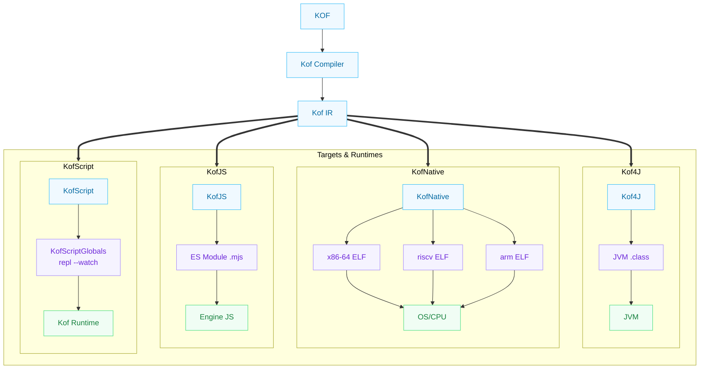

[English](00-introduction.md) | [Português](00-introduction.pt_BR.md)

# 00 — Introduction

> **Kof 0.5.0-beta — Sep 2026 — targets jvm/native/native.risc/native.arm/js/kofc**

## What Kof is

Kof is a programming language compiled for multiple platforms.

It exists for a simple reason: Java is one of the most powerful platforms in the world, but it demands an absurd amount of code to express simple ideas.

Kof keeps the power of the JVM and the Java ecosystem, but removes most of the ceremony. And now, that same language generates native binaries for Linux x86-64, RISC-V 64 (`native.risc`) and AArch64 (`native.arm`), ES Modules via KofJS (`js`) and C binaries via **KofC** (`kof c <file.c>` native-only) — all from the same frontend `intention->Kof->frontend->IR->backend->runtime`.

## The multiplatform vision

Kof is not just a language for the JVM. It is a language that can compile to different targets:



**The language does not change. The target changes.**

This means you can write the same Kof code and compile it to:
- **JVM** — `.class` bytecode that runs on any JVM
- **Native** — ELF x86-64 executable (`--target=native`) that runs directly on Linux
- **Native RISC-V** — ELF riscv64 via `--target=native.risc` (cross with `riscv64-linux-gnu-as/ld` + qemu, placeholder separate from `native`)
- **Native ARM** — ELF aarch64 via `--target=native.arm` (cross with `aarch64-linux-gnu-as/ld` + qemu)
- **KofJS** — ES Modules (ECMAScript 2022+) executed in the embedded
  JS engine (without Node); `kof.ui` renders in a native webview or browser.
  See [chapter 37](37-kofjs.md).
- **KofScript** — direct execution with `kof script` / `kof repl`, top-level `var`/`val` become persistent `KofScriptGlobals` (no `let`/`const` — JS sugar removed 06/09), `--watch` re-executes on save
- **KofC** — `kof c <file.c>` compiles a subset of C (`int` globals, `void` funcs, `if`/`while`/`*(int*)`/`&`) straight to a native-only x86-64 ELF

> **Target separation:** the `Target` enum now distinguishes `JVM | NATIVE | NATIVE_RISCV64 | NATIVE_AARCH64 | JS | ANDROID`; `parseTarget` accepts `native.risc`/`native.riscv64` and `native.arm`/`native.aarch64`.

## The visual comparison

Java:

```java
public final class User {

    private final String name;
    private final String email;

    public User(String name, String email) {
        this.name = name;
        this.email = email;
    }

    public String name() {
        return name;
    }

    public String email() {
        return email;
    }

    @Override
    public boolean equals(Object o) {
        if (this == o) return true;
        if (!(o instanceof User other)) return false;
        return Objects.equals(name, other.name)
            && Objects.equals(email, other.email);
    }

    @Override
    public int hashCode() {
        return Objects.hash(name, email);
    }

    @Override
    public String toString() {
        return "User[name=" + name + ", email=" + email + "]";
    }
}
```

Kof:

```kf
record User(String name, String email)
```

The compiler generates exactly the same thing: a JVM class with fields, constructor, accessors, equals, hashCode and toString.

## Philosophy

> The chain that Kof preserves: **intention->Kof->frontend->IR->backend->runtime**. You write the intention; the frontend (`lexer -> parser -> AST`) becomes IR; the backend (`jvm/native/js/kofc`) decides the mechanism. See `docs/philosophy.md` and `learn/28-language-design.md`.

Kof follows three principles:

**1. Less code, same capability.**

Every line you write in Kof must have the same semantic weight as the equivalent in Java. We don't remove functionality — we remove repetition.

**2. Strong typing, static compilation.**

The compiler knows your types. Errors are found before the program runs. This does not change — it is one of the great strengths of the JVM.

**3. The platform takes care of the runtime.**

Kof does not invent a garbage collector, scheduler, or memory model in the user's code. On the JVM, the JVM does everything. In Native, the runtime has a **free-list GC** (`kof_free_head`, reuse via `mmap`, mark-sweep pending) and its own allocator — the program never calls `malloc`/`free`.

0.2.0 novelties that follow the same philosophy: pattern matching with `case String s` and destructuring `Point(x,y)`, basic `String?`, `List map/filter/reduce`, `kof.http` in JVM+JS, `a.b.C` imports fixed for large projects, and `kof_db` with **MySQL via `kof_db`** (native wire protocol in progress) in addition to the already stable SQLite.

## Relationship with Java

Kof is **compatible with Java**, it is not a substitute.

Kof code generates standard JVM bytecode. That bytecode can:
- be called by Java code
- call Java code
- use any Java library
- run on any JVM

Kof does not rewrite the Java ecosystem. Kof connects to it.

## Relationship with Kotlin

Kotlin solves the same problem (Java is verbose) in a different way.

Kotlin added many new features to the language: data classes, sealed classes, coroutines, extension functions, null safety, etc.

Kof tries to solve the same problem in a more minimalist way. Instead of adding many new features, Kof tries to express the same ideas from Java with less code.

If an idea from another language is better, Kof can adopt the idea. There is no fanaticism here.

## What Kof does NOT try to solve

Kof does not try to be:
- a functional language
- a language for distributed systems
- a language for machine learning

Kof tries to be the best way to write object-oriented code for the
JVM, for native binaries (x86-64, riscv64, aarch64) and — via KofJS — for the web (frontend with
`kof.ui` + `kof run --target=js`; see [chapter 37](37-kofjs.md)).

## Why "Kof"

The name is short, easy to type, and does not conflict with any known Java library.

## How it works under the hood

```
You write:        record User(String name)          // intention
                        ↓
Kof compiler:     lexer → parser → AST → IR → backend   // intention->Kof->frontend->IR->backend->runtime
                        ↓
                  ┌──────┼──────┐
                  │      │      │
               JVM    Native   JS
                  │      │      │
                  ▼      ▼      ▼
             User.class ELF*  .mjs
                  │      │      │
                  ▼      ▼      ▼
              works    executable ES Module
              as a     directly on in the
              class    Linux       embedded engine
              Java normal (x86-64/riscv/arm)
```

`*` Native includes `native` (x86-64), `native.risc` (riscv64) and `native.arm` (aarch64) — selection via the `Target` enum.

There is no Java generation step. The compiler generates bytecode or native code directly. For the **KofScript** target (direct script/REPL execution), the same optimized IR is executed by the `KofInterpreter` — without emitting bytecode or forking a JVM — with parity by construction with the JVM backend (same frontend, same IR).

## Next step

[Let's install everything →](01-installation.md)
