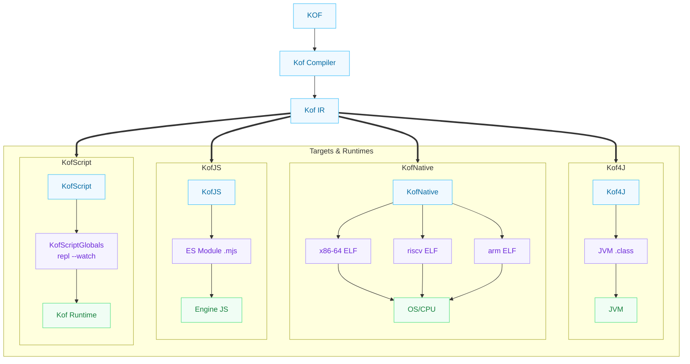
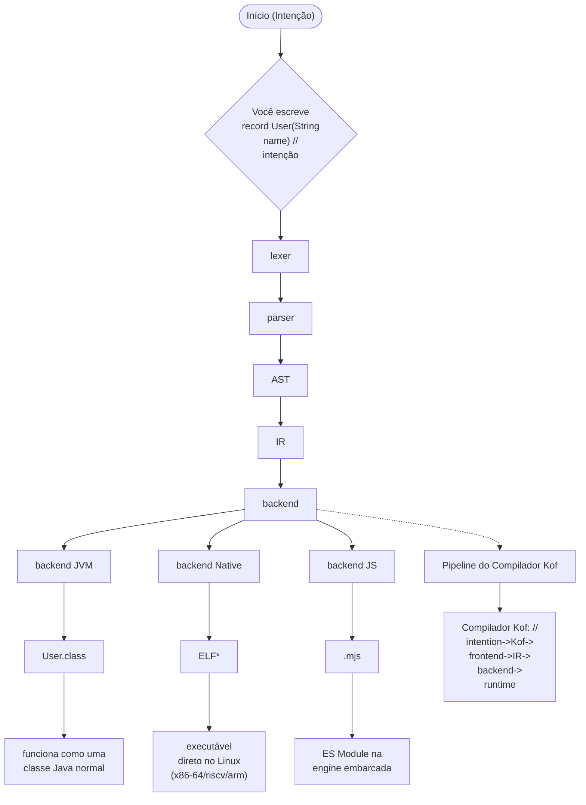

[English](00-introduction.md) | [Português](00-introduction.pt_BR.md)

# 00 — Introdução

> **Kof 0.5.0-beta — set 2026 — targets jvm/native/native.risc/native.arm/js/kofc**

## O que é Kof

Kof é uma linguagem de programação compilada para múltiplas plataformas.

Ela existe por uma razão simples: Java é uma das plataformas mais poderosas do mundo, mas exige uma quantidade absurda de código para expressar ideias simples.

Kof mantém o poder da JVM e do ecossistema Java, mas remove a maior parte da ceremony. E agora, essa mesma linguagem gera binários nativos para Linux x86-64, RISC-V 64 (`native.risc`) e AArch64 (`native.arm`), ES Modules via KofJS (`js`) e binários C via **KofC** (`kof c <file.c>` nativo-only) — tudo a partir do mesmo frontend `intention->Kof->frontend->IR->backend->runtime`.

## A visão multiplatform

Kof não é apenas uma linguagem para a JVM. É uma linguagem que pode compilar para diferentes targets:



**A linguagem não muda. O target muda.**

Isso significa que você pode escrever o mesmo código Kof e compilar para:
- **JVM** — bytecode `.class` que roda em qualquer JVM
- **Native** — executável ELF x86-64 (`--target=native`) que roda direto no Linux
- **Native RISC-V** — ELF riscv64 via `--target=native.risc` (cross com `riscv64-linux-gnu-as/ld` + qemu, placeholder separado de `native`)
- **Native ARM** — ELF aarch64 via `--target=native.arm` (cross com `aarch64-linux-gnu-as/ld` + qemu)
- **KofJS** — ES Modules (ECMAScript 2022+) executados na engine JS
  embarcada (sem Node); `kof.ui` renderiza em webview nativo ou browser.
  Ver [capítulo 37](37-kofjs.md).
- **KofScript** — execução direta com `kof script` / `kof repl`, `var`/`val` no topo viram `KofScriptGlobals` persistentes (sem `let`/`const` — sugar JS removido 06/09), `--watch` re-executa ao salvar
- **KofC** — `kof c <file.c>` compila um subset de C (`int` globals, `void` funcs, `if`/`while`/`*(int*)`/`&`) direto para ELF x86-64 nativo-only

> **Target separation:** `Target` enum agora distingue `JVM | NATIVE | NATIVE_RISCV64 | NATIVE_AARCH64 | JS | ANDROID`; `parseTarget` aceita `native.risc`/`native.riscv64` e `native.arm`/`native.aarch64`.

## A comparação visual

Java:

```java
public final class User {

    private final String name;
    private final String email;

    public User(String name, String email) {
        this.name = name;
        this.email = email;
    }

    public String name() {
        return name;
    }

    public String email() {
        return email;
    }

    @Override
    public boolean equals(Object o) {
        if (this == o) return true;
        if (!(o instanceof User other)) return false;
        return Objects.equals(name, other.name)
            && Objects.equals(email, other.email);
    }

    @Override
    public int hashCode() {
        return Objects.hash(name, email);
    }

    @Override
    public String toString() {
        return "User[name=" + name + ", email=" + email + "]";
    }
}
```

Kof:

```kf
record User(String name, String email)
```

O compilador gera exatamente a mesma coisa: uma classe JVM com campos, construtor, accessors, equals, hashCode e toString.

## Filosofia

> A cadeia que o Kof preserva: **intention->Kof->frontend->IR->backend->runtime**. Você escreve a intenção; o frontend (`lexer -> parser -> AST`) vira IR; o backend (`jvm/native/js/kofc`) decide o mecanismo. Ver `docs/philosophy.md` e `learn/28-language-design.md`.

Kof segue três princípios:

**1. Menos código, mesma capacidade.**

Cada linha que você escreve em Kof precisa ter o mesmo peso semântico que a equivalente em Java. Não removemos funcionalidade — removemos repetição.

**2. Tipo forte, compilação estática.**

O compilador conhece seus tipos. Erros são encontrados antes de o programa rodar. Isso não muda — é uma das grandes forças da JVM.

**3. A plataforma cuida do runtime.**

Kof não inventa garbage collector, scheduler, ou modelo de memória no código do usuário. Na JVM, a JVM faz tudo. No Native, o runtime tem **free-list GC** (`kof_free_head`, reuso via `mmap`, mark-sweep pendente) e allocator próprio — o programa nunca chama `malloc`/`free`.

Novidades 0.2.0 que seguem a mesma filosofia: pattern matching com `case String s` e destructuring `Point(x,y)`, `String?` básico, `List map/filter/reduce`, `kof.http` em JVM+JS, imports `a.b.C` corrigidos para projetos grandes, e `kof_db` com **MySQL via `kof_db`** (wire protocol nativo em progresso) além do SQLite já estável.

## Relação com Java

Kof é **compatível com Java**, não é um substituto.

Código Kof gera bytecode JVM padrão. Esse bytecode pode:
- ser chamado por código Java
- chamar código Java
- usar qualquer biblioteca Java
- rodar em qualquer JVM

Kof não reescreve o ecossistema Java. Kof se conecta a ele.

## Relação com Kotlin

Kotlin resolve o mesmo problema (Java é verboso) de uma forma diferente.

Kotlin adicionou muitas features novas à linguagem: data classes, sealed classes, coroutines, extension functions, null safety, etc.

Kof tenta resolver o mesmo problema de uma forma mais minimalista. Em vez de adicionar muitas features novas, Kof tenta expressar as mesmas ideias do Java com menos código.

Se uma ideia de outra linguagem for melhor, Kof pode adotar a ideia. Não há fanatismo aqui.

## O que Kof NÃO tenta resolver

Kof não tenta ser:
- uma linguagem funcional
- uma linguagem para sistemas distribuídos
- uma linguagem para machine learning

Kof tenta ser a melhor forma de escrever código orientado a objetos para a
JVM, para binários nativos (x86-64, riscv64, aarch64) e — via KofJS — para a web (frontend com
`kof.ui` + `kof run --target=js`; ver [capítulo 37](37-kofjs.md)).

## Por que "Kof"

O nome é curto, fácil de digitar, e não conflita com nenhuma biblioteca Java conhecida.

## Como funciona por baixo



`*` Native inclui `native` (x86-64), `native.risc` (riscv64) e `native.arm` (aarch64) — seleção via `Target` enum.

Não existe etapa de geração de Java. O compilador gera bytecode ou código nativo diretamente. Para o target **KofScript** (execução direta de script/REPL), a mesma IR otimizada é executada pelo `KofInterpreter` — sem emitir bytecode nem fork de JVM — com paridade por construção com o backend JVM (mesmo frontend, mesma IR).

## Próximo passo

[Vamos instalar tudo →](01-installation.md)
